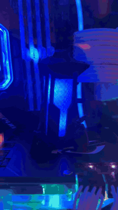
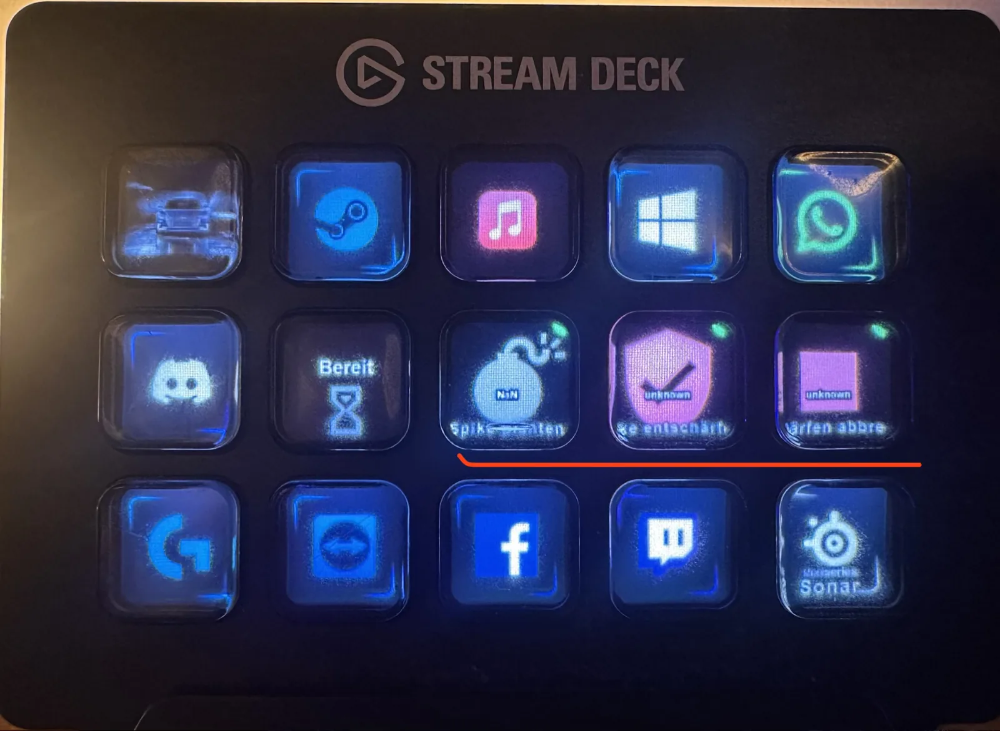

<div align="center">

# 💣 Valorant Spike

**A 3D printed replica of the Spike from Valorant for my gaming PC, with LEDs, original sounds and a working defuse.**

[](https://www.espressif.com/)
[](#case)
[](#controls)
[](LICENSE)


</div>

---

## What it is

In Valorant the Spike is the bomb that one team plants and the other team has to defuse (a bit like the bomb in Counter-Strike). I wanted one for my gaming PC, but I couldn't find a similar project, so I built it myself.

- The case is 3D printed.
- One RGB LED at the top and one at the bottom make it glow and show when the Spike is half defused. A MOSFET switches them.
- An ESP32 D1 Mini drives the LEDs and talks to the PC over USB.
- The sounds, animations and timing are the same as the real Spike in the game. Every sound was recorded on its own and plays through the PC speakers.
- You can plant it, defuse it, or stop a defuse halfway, just like in the game.
- Everything is triggered with keys on an Elgato Stream Deck.

You can see it in action on my [setup page](https://d-mohles.de/setup).

## Video

The Spike in my PC: first the plant, then the defuse.



The full clip with sound is here: [spike.mp4](https://github.com/dev-dany97/valorant-spike/raw/main/docs/video/spike.mp4) (60 s, 11.5 MB, opens as a download).

## How it works

```
 Stream Deck key ──► PC ──(USB serial)──► ESP32 D1 Mini ──► MOSFET ──► LEDs (top + bottom)
                     │
                     └──► sound playback on the PC speakers
```

1. A key on the Stream Deck starts an action on the PC: plant, defuse or stop the defuse.
2. The PC plays the matching sound and sends a command over USB to the ESP32.
3. The ESP32 runs the LED animation with the same timing as in the game: slow blinking after the plant, faster towards the end, and the half-defused state.

## Parts

| Part | Notes |
|---|---|
| ESP32 D1 Mini | Drives the LEDs, connected to the PC over USB |
| MOSFET | Switches the LEDs |
| 2 × 5 mm RGB LED | One at the top, one at the bottom. I used a 25-pack from Lumetheus (Amazon, about 7.90 €): 4 pins, 3 V, red 400 / green 1500 / blue 700 mcd |
| 3D printed case | Outer shell and inner glow part, see [Build your own](#build-your-own) |
| USB cable | Power and data |
| Elgato Stream Deck | Keys for plant, defuse and stop |

## Case

| Model | Stream Deck keys |
|---|---|
|  |  |

In my PC the Spike sits right on top of the graphics card:


## Build your own

All files you need are in this repo:

| Folder | Content |
|---|---|
| [`models/`](models) | `obj_2_spikefinal.stl`: the outer shell (about 49 × 56 × 83 mm)<br>`obj_1_glow.stl`: the inner glow part that sits behind the LEDs (about 25 × 25 × 69 mm) |
| [`sounds/`](sounds) | `spike_plant.mp3`, `spike_countdown.mp3`, `spike_defuse.mp3`, `spike_defused.mp3`, `spike_explosion.mp3` |

I ordered both parts on [Craftcloud](https://craftcloud3d.com/). You upload the STL, pick the material and Craftcloud sends the order to a print shop. This is what I chose:

| Part | Process and material | Printed in | Cost |
|---|---|---|---|
| Outer shell (`obj_2_spikefinal.stl`) | Resin print, Standard Resin, Natural Black | Slovakia | 39.41 € |
| Glow part (`obj_1_glow.stl`) | FDM, PVB Standard Smooth, Natural Translucent, 40 % infill | Germany | 29.87 € |

The prices include shipping (7.00 € and 6.53 €) and 19 % VAT. Together with the LEDs the Spike cost me about 77 €, without the ESP32, the MOSFET and the Stream Deck, which I already had. Prices on Craftcloud change with the shop and the day, so treat these numbers as a rough guide.

## Controls

| Stream Deck key | What happens |
|---|---|
| Plant | Plant sound, then the Spike starts blinking |
| Defuse | Defuse sound, the LEDs show the progress |
| Stop defuse | The defuse is stopped and the Spike keeps ticking |

## Disclaimer

Valorant and the Spike are trademarks of Riot Games. This is a private fan project and is not affiliated with or endorsed by Riot Games. The sounds in [`sounds/`](sounds) were recorded from the game, they belong to Riot Games and are only here so you can rebuild this fan project for private use.

## License

[MIT](LICENSE)
