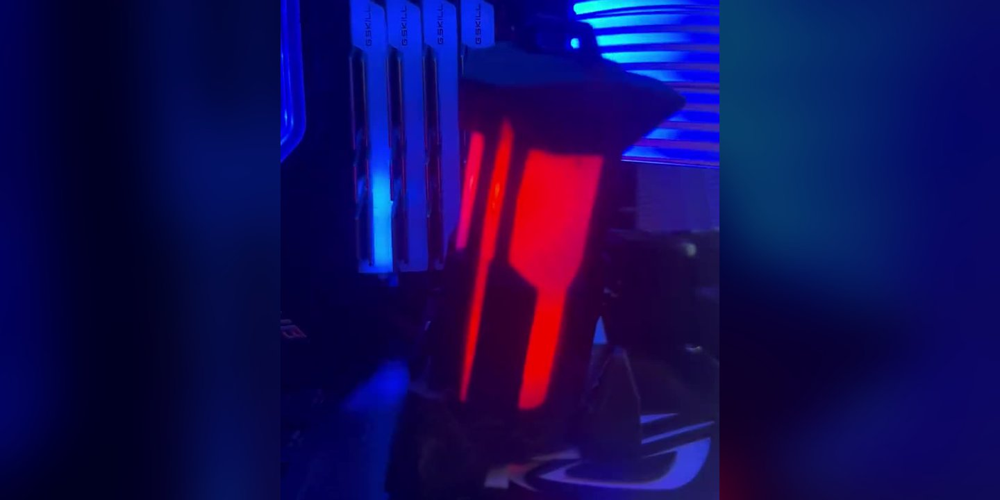
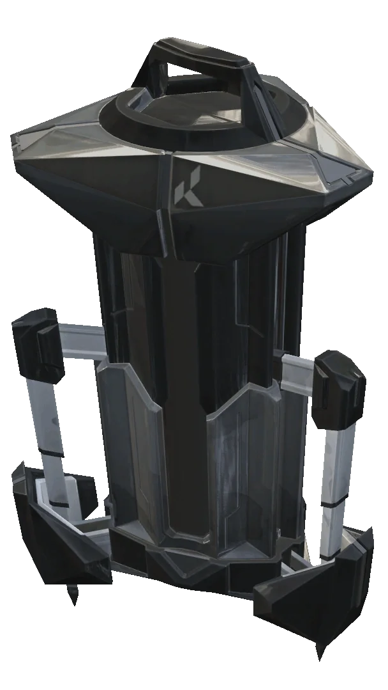
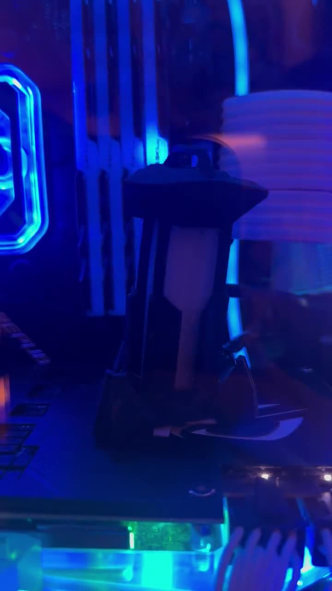

<div align="center">

# 💣 Valorant Spike

**A 3D printed replica of the Spike from Valorant for my gaming PC, with LEDs, original sounds and a working defuse.**

[](https://www.espressif.com/)
[](#case)
[](#controls)
[](LICENSE)



</div>

---

## What it is

In Valorant the Spike is the bomb that one team plants and the other team has to defuse (a bit like the bomb in Counter-Strike). I wanted one for my gaming PC, but I couldn't find a similar project, so I built it myself.

- The case is 3D printed.
- One LED at the top and one at the bottom make it glow and show when the Spike is half defused.
- An ESP32 D1 Mini drives the LEDs and talks to the PC over USB.
- The sounds, animations and timing are the same as the real Spike in the game. Every sound was recorded on its own and plays through the PC speakers.
- You can plant it, defuse it, or stop a defuse halfway, just like in the game.
- Everything is triggered with keys on an Elgato Stream Deck.

You can see it in action on my [setup page](https://d-mohles.de/setup).

## How it works

```
 Stream Deck key ──► PC ──(USB serial)──► ESP32 D1 Mini ──► LEDs (top + bottom)
                     │
                     └──► sound playback on the PC speakers
```

1. A key on the Stream Deck starts an action on the PC: plant, defuse or stop the defuse.
2. The PC plays the matching sound and sends a command over USB to the ESP32.
3. The ESP32 runs the LED animation with the same timing as in the game: slow blinking after the plant, faster towards the end, and the half-defused state.

## Parts

| Part | Notes |
|---|---|
| ESP32 D1 Mini | Drives the LEDs, connected to the PC over USB |
| 2 LEDs | One at the top, one at the bottom |
| 3D printed case | Printed in several parts |
| USB cable | Power and data |
| Elgato Stream Deck | Keys for plant, defuse and stop |

## Case

| Model | Stream Deck keys |
|---|---|
|  |  |

In my PC the Spike sits right on top of the graphics card:



## Controls

| Stream Deck key | What happens |
|---|---|
| Plant | Plant sound, then the Spike starts blinking |
| Defuse | Defuse sound, the LEDs show the progress |
| Stop defuse | The defuse is stopped and the Spike keeps ticking |

## Disclaimer

Valorant and the Spike are trademarks of Riot Games. This is a private fan project and is not affiliated with or endorsed by Riot Games. The game sounds are not included in this repository.

## License

[MIT](LICENSE)
